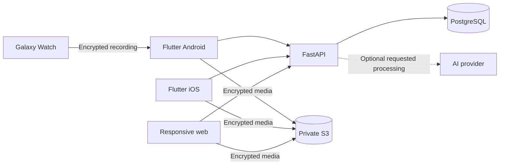

# Memo Z journaling app architecture

Memo Z is a private daily journal for Flutter on Android and iOS, a responsive website, and a one-tap voice recorder for Samsung Galaxy Watch. A single FastAPI service coordinates accounts and sync. PostgreSQL stores journal records, and private S3 stores media. Clients encrypt journal content before it leaves the device for storage. The owner can read it after unlocking the journal. Users who want cloud transcription or AI formatting add their own provider API key in Profile.

## Product scope

| Surface | Experience |
| --- | --- |
| Flutter mobile | Profile, journal list, calendar, writing, inline media, voice capture, transcription, formatting, sync status, and settings. Use Flutter Material 3 components, native pickers, and native permissions. |
| Responsive web | The same core journal and account features, with React, TypeScript, and Material UI. Use a sidebar on wide screens and Material bottom navigation on small screens. The browser can record audio, pick files, and edit or display context synced from a phone. Phone-specific data sources are collected by the mobile app. |
| Samsung Galaxy Watch | A Kotlin Wear OS companion for Galaxy Watch4 and later, paired with Android. One microphone button starts or stops recording, with a timer and handoff status. [Samsung Wear OS support](https://developer.samsung.com/galaxy-watch-tizen/notice.html) |
| Desktop | Use the responsive web app for now. The API and document format can support a Flutter desktop client later. |

An entry has a title, an editable journal date, a time zone, and an ordered body. Users can create several entries for a day. Creation time, capture time, and journal date are independent, so moving a journal entry between calendar days preserves when it was made. Use a small versioned JSON document schema for paragraphs, heading levels, basic inline styling, lists, links, emoji, symbols, and media blocks. Users place photos, GIFs, video, and audio between paragraphs and can reorder them. Videos appear inline with a tap-to-play preview and no autoplay. Load media on demand and set per-file size limits based on memory and upload behavior on the supported devices. Flutter and web editors read and write the same schema. Verify round-trip editing with real mixed-media entries before committing to the editor pair.

Use the same indigo accent, cool neutral surfaces, and Today, All entries, Calendar, and Profile navigation across web and mobile. Keep components native to each platform. [Flutter Material design](https://docs.flutter.dev/ui/design/material), [React Material UI](https://mui.com/material-ui/getting-started/)

## Service and storage

Run one stateless FastAPI application with a same-origin web frontend and HTTPS. Keep account/session management, journal sync, upload grants, and provider adapters as modules in that service. Use managed PostgreSQL with backups, a private S3 bucket, and a small maintenance task for expired upload cleanup. Start with a single API contract for mobile and web. [FastAPI documentation](https://fastapi.tiangolo.com/), [Flutter platform channels](https://docs.flutter.dev/platform-integration/platform-channels)

| PostgreSQL records | Stored data |
| --- | --- |
| Accounts, devices, and sessions | Account ID, login identifiers, password hash, revocable sessions, device registrations, and encrypted vault-key envelopes. |
| Private profile | Encrypted display name, time zone preference, units, reminder preferences, and selected sources and metrics. Device permissions are checked on the device that granted them. |
| Entries and revisions | Opaque entry and revision IDs, a separately encrypted calendar/list header, encrypted body and context, and parent revision references. The encrypted header carries the journal date and title. |
| Attachments | Owner ID, opaque S3 key, ciphertext size and checksum, upload state, and revision references. S3 stores encrypted images, GIFs, videos, voice recordings, and any generated media previews. |
| Formatting and transcription | Encrypted Markdown skills, settings, provider keys, source text, transcript versions, formatting results, and the source revision, skill version, and model used for each result. |
| Sync | Per-account change cursor, mutation IDs, revision pointers, and deletion markers. |

Each piece of user content has one primary store. PostgreSQL is authoritative for structured records and references. S3 is authoritative for media bytes. Keep bucket access private and issue short-lived grants for specific objects after checking ownership. Upload encrypted bytes directly from the client, verify the checksum and size before finalizing, and link attachments to revisions in a PostgreSQL transaction. Give each upload a unique object key and use conditional creation to prevent overwriting a completed upload on retry. Coordinate cleanup with finalization so an active upload cannot be removed. Encrypt managed storage and backups as a second layer. Define a retention window for deleted revisions and backups before launch. [S3 presigned URLs](https://docs.aws.amazon.com/AmazonS3/latest/userguide/using-presigned-url.html), [S3 checksums](https://docs.aws.amazon.com/AmazonS3/latest/userguide/checking-object-integrity-upload.html), [S3 conditional writes](https://docs.aws.amazon.com/AmazonS3/latest/userguide/conditional-writes.html)

## Privacy and sign-in

- **Journal keys.** Generate a random vault key on the client. Use audited libraries and a versioned authenticated-encryption format that works in Dart, Kotlin, and the browser where applicable. AES-GCM requires unique nonces for each key. Encrypt titles, dates, text, attachments, provider keys, skills, and personal context. The service sees operational metadata such as account IDs, sync times, record counts, and ciphertext sizes. It needs login identifiers to authenticate accounts. [AES-GCM in Web Crypto](https://developer.mozilla.org/en-US/docs/Web/API/AesGcmParams)
- **Unlock and recovery.** Keep the mobile vault key protected by the OS keystore or Keychain. Give the owner a recovery key at setup and use it to wrap the vault key that is synced to the account. Keep the unwrapped key in memory on web. A new device or a browser without the key in memory needs the recovery key to unlock the journal, even if the owner is still signed in. A password reset can restore account access, while journal recovery requires the recovery key or a previously unlocked device. Document the limits of browser trust since the website supplies the code that unlocks the journal.
- **Sessions.** Start with username and password, Argon2id password hashing, rate-limited sign-in, and short-lived signed access JWTs. Check JWT issuer, audience, expiration, and signature. Issue a refresh token for every authenticated browser session at sign-in. Store it in a Secure, HttpOnly, SameSite cookie with a bounded lifetime and use CSRF protection. Reuse that session across reloads and tabs and after browser restart when cookies persist. Rotate the refresh token on each successful refresh, serialize refresh requests across tabs, and store token hashes in PostgreSQL. Support per-device session revocation and revoke the affected refresh session on token reuse or sign-out. Require sign-in again when the refresh session expires or is revoked. Mobile uses OS-protected refresh token storage. Enforce account ownership for every read, write, and media grant. [OWASP password storage](https://cheatsheetseries.owasp.org/cheatsheets/Password_Storage_Cheat_Sheet.html), [OWASP session management](https://cheatsheetseries.owasp.org/cheatsheets/Session_Management_Cheat_Sheet.html), [Refresh token rotation](https://www.rfc-editor.org/rfc/rfc9700.html#section-4.14.2)
- **Future authentication.** Keep a stable internal account ID and independent account authentication and vault recovery. Add a verified email or phone identity if OTP sign-in is adopted. Firebase or another delivery/identity provider can verify those challenges without changing the journal schema. Use passkeys or an authenticator app for higher-assurance MFA. Treat email codes as lower-assurance sign-in or contact verification and SMS as a restricted fallback. [NIST authentication guidance](https://pages.nist.gov/800-63-4/sp800-63b.html)
- **Data handling.** Keep journal contents, API keys, tokens, and signed media links out of logs and crash reports. Apply a restrictive Content Security Policy, avoid third-party scripts in the journal, and render user and model content through the same safe block renderer. Offer account deletion in Profile and from the website. Deletion revokes sessions and schedules cleanup of the user's database data and S3 objects under the retention policy. [Apple App Review Guidelines](https://developer.apple.com/app-store/review/guidelines/), [Google Play account deletion requirements](https://support.google.com/googleplay/android-developer/answer/13327111?hl=en)

## Offline capture and sync

The local storage exception is a temporary encrypted queue for unsynced changes and media. It covers a weak connection or a failed upload as well as airplane mode. Keep synced entries and previews only in active memory during use. The phone and watch protect queue keys with OS facilities and exclude the queue from automatic backups. On the web, cache the app shell after the first online visit and use IndexedDB for encrypted pending changes. Keep the recovery-wrapped vault key alongside a nonempty outbox so the owner can reopen pending drafts offline with their recovery key. Clear that envelope when its queue empties. Browser storage can be evicted, so request persistent storage where supported and surface its limits in the sync UI. Offline access covers queued drafts and entries already loaded in the current session. [Browser storage and eviction](https://developer.mozilla.org/en-US/docs/Web/API/Storage_API/Storage_quotas_and_eviction_criteria), [Browser background sync](https://developer.mozilla.org/en-US/docs/Web/API/Background_Synchronization_API)

1. Write each change durably to the encrypted queue with a stable entry ID, mutation ID, and base revision. Show **Sync pending** immediately. If the device cannot write a draft, report that it could not save it.
2. Retry on reconnect and app reopen, with eligible background retries where the OS supports them. Keep an explicit retry action and distinguish waiting for sign-in, waiting for network, and failed upload. Upload any media first, then commit the entry revision. Replaying a mutation ID returns the existing result.
3. Show **Synced** and clear the queue item only after the API acknowledges the revision and all its media. Use an account-scoped change cursor advanced atomically with the corresponding committed updates. Download encrypted headers and deletion markers incrementally for list and calendar views. Decrypt them in memory and fetch full bodies or media on demand.
4. If two devices edit the same base revision, keep both encrypted versions and let the owner resolve them. Apply the same rule when an offline edit meets an entry deletion.

### Watch handoff

Pair the watch with the signed-in Android app and provision a capture key scoped to that account and watch. Encrypt each completed recording on the watch and assign it a unique capture ID. Send the encrypted file as a Wear OS Data Layer asset and use the same app identity and signing certificate on Android and Wear OS. The phone acknowledges the recording ID after saving it durably to its encrypted inbox. The watch then clears the recording and the Data Layer item. The phone converts it to a vault attachment when the owner's vault is available, creates a voice entry, and follows regular sync. Duplicate deliveries reuse the capture ID. The watch shows **Waiting for phone** or **Sent to phone** and the phone shows the separate cloud status. Wear OS can route Data Layer traffic via Google infrastructure when Bluetooth is unavailable, so apply the journal's own encryption before handing over the file. [Wear OS Data Layer](https://developer.android.com/training/wearables/data/overview), [Wear OS assets and clients](https://developer.android.com/training/wearables/data/client-types)

## Voice and Markdown formatting

- **Record and preserve the source.** Capture from an explicit microphone action and show a timer, stop control, and permission or interruption state. Use native noise suppression during capture where supported and expose a recording setting for it. Save the audio delivered by the device as the source recording. If a later cleanup pass improves transcription, process a copy and preserve the source. Capture-time suppression changes the source, so the recording setting should make that clear. Measure speech intelligibility on the watch and phone in noisy environments. [Android noise suppressor](https://developer.android.com/reference/android/media/audiofx/NoiseSuppressor), [Apple audio voice processing](https://developer.apple.com/videos/play/wwdc2019/510/), [Browser noise suppression support](https://developer.mozilla.org/en-US/docs/Web/API/MediaTrackConstraints/noiseSuppression)
- **Transcribe on demand.** Profile settings hold a provider, an API key, and a compatible model ID. Start with one verified transcription adapter, such as OpenAI's recorded-speech model, and use a small capabilities catalog for formats, limits, languages, and optional timestamps or speaker labels. Add adapters such as Deepgram by demand. Allow manually entered model IDs on an existing adapter after validation. Keep the original audio, the first transcript as returned by the provider, and later transcript edits or reruns. Voice alone has no text until it is transcribed. Preserve any independently typed source text with its own revision. [OpenAI speech-to-text guide](https://developers.openai.com/api/docs/guides/speech-to-text), [Deepgram model catalog](https://developers.deepgram.com/docs/models-languages-overview)
- **Format with a skill.** Let users import or paste a Markdown file in Profile, and pick a saved skill from **Format** on an entry. An ordinary template can insert headings locally. For AI rewriting, use the formatting provider and model selected in Profile independently of the transcription model. Pass the selected text and skill to the adapter, request schema-validated document blocks, and preview the result. Treat the Markdown as instructions for formatting only. The model receives no tools or access to the rest of the vault. Keep inline attachments anchored to existing IDs and preserve the original version and the formatted result separately. [Structured model outputs](https://developers.openai.com/api/docs/guides/structured-outputs)
- **Use the owner’s API key for cloud processing.** Keep cloud AI off until the user adds their own key for the selected provider in Profile. Writing, recording, sync, and local templates are available independently of AI setup. For each requested cloud run, the unlocked client sends only the selected audio or text, the chosen skill for formatting, and the owner’s provider credential over HTTPS to a narrow, stateless FastAPI relay. The relay and selected provider process plaintext for that run. The relay saves no plaintext payload and has no access to vault decryption keys. Explain the provider's retention terms in settings, and encrypt each returned result on the client before saving it. Failed or offline processing leaves the source ready to try again. [OpenAI API data controls](https://developers.openai.com/api/docs/guides/your-data)

## Personal profile and daily context

Give the owner a **Today** view that also opens for any day in the calendar. It brings together that day's journal entries, voice captures, a quick mood and energy check-in, and the context the owner chooses to save. A check-in can be saved on its own. Use **Profile** for display name, time zone, units, reminder preferences, account and vault controls, AI settings, and **Connected data**. Keep the profile and timeline private to the account.

Make each source opt-in and show what it will add before attaching it to an entry. Store an encrypted snapshot with source, the relevant local date/time zone, and retrieval time. Let users remove a snapshot and disconnect a source separately. Missing data stays missing. For integrations available only on a phone, the web can read and edit snapshots after sync and directs users to the phone to change device permissions.

| Context | Implementation | Release |
| --- | --- | --- |
| Gallery | Let users select photos, GIFs, and videos using the Android or iOS picker or web file selection. Add a by-date suggestions flow later if users want it. [Android photo picker](https://developer.android.com/training/data-storage/shared/photo-picker), [Apple PhotosPicker](https://developer.apple.com/documentation/photosui/photospicker) | Core |
| Location and weather | Capture an optional location when journaling or let the user choose a place. For old entries, look up the chosen place and journal date in a historical weather API. If the date or place changes, mark the weather snapshot out of date until refreshed. Send only the date and rounded coordinates to the weather service. Open-Meteo is a candidate with separate current and historical APIs and commercial use terms. [Historical weather](https://open-meteo.com/en/docs/historical-weather-api), [Open-Meteo pricing and terms](https://open-meteo.com/en/pricing) | Core |
| Health | Read steps and sleep from the phone's health store with per-metric permission. Show the user a daily preview and save the selected values as encrypted context. Provide a manual check-in for days with missing data and devices without an available connection. | After core |
| Screen time | On Android, request Usage Access in system settings and offer a daily total and optionally time by app. The API provides usage statistics and events. On iOS, assess entitlement and distribution eligibility. The standard DeviceActivity report extension runs in a sandbox that restricts moving sensitive report data outside it, so plan manual entry on iOS and web. [Android usage stats](https://developer.android.com/reference/android/app/usage/UsageStatsManager), [Apple Family Controls entitlement](https://developer.apple.com/documentation/familycontrols/requesting-the-family-controls-entitlement), [Apple DeviceActivity report](https://developer.apple.com/documentation/deviceactivity/deviceactivityreport?language=objc) | After core |
| Spending | Let the user enter a daily spending total and currency or import a spending CSV they select. Calculate the agreed summary on the client and store it as encrypted context. | After core |
| Calendar events | Read events for the selected day through Android Calendar Provider or iOS EventKit after permission. Let the user choose which events to attach and preview the title and time. iOS requires full calendar access to read existing events, which makes this a good candidate to validate with users first. [Android Calendar Provider](https://developer.android.com/identity/providers/calendar-provider), [Apple EventKit access](https://developer.apple.com/videos/play/wwdc2023/10052/) | Feature candidate |

### Health connection options

| Option | Fit for Memo Z |
| --- | --- |
| **Android Health Connect** | First Android integration. One on-device adapter can read data that Google Fit, Samsung Health, and other compatible apps share. Galaxy Watch health data follows **Watch → Samsung Health on the phone → Health Connect → Memo Z**. Android 14 and later include Health Connect. Android 9 through 13 need the Health Connect app and a supported device with Google Play services. [Android availability](https://developer.android.com/health-and-fitness/health-connect/availability), [Google Fit setup](https://support.google.com/fit/answer/12830119), [Samsung Health setup](https://developer.samsung.com/health/blog/en/accessing-samsung-health-data-through-health-connect) |
| **Apple HealthKit** | First iOS option. Use native read authorization for steps and sleep on the iPhone. Offer **Apple Health** in Profile when the adapter is available. Apple can return an empty read when data is unavailable or access was denied, so show a neutral **No data available** state. [HealthKit authorization](https://developer.apple.com/documentation/healthkit/authorizing-access-to-health-data) |
| **Google Health API** | Candidate if Fitbit or Pixel Watch cloud data, or a connection that can work without a companion phone, becomes important. It adds Google OAuth, scoped access, and provider review. It is a distinct integration from Health Connect. [Google Health API overview](https://developers.google.com/health/about), [Google Health API setup](https://developers.google.com/health/get-started) |
| **Samsung Health Data SDK** | Candidate if a specific Samsung metric matters and is unavailable through Health Connect. It requires Samsung Health on the Android phone and Samsung partner approval for production distribution. [Samsung SDK requirements](https://developer.samsung.com/health/data/faq.html), [Samsung app verification](https://developer.samsung.com/health/data/guide/app-verification.html) |
| **Legacy Google Fit APIs** | Google documents support through the end of 2026. Users can connect the Google Fit app as a source through Health Connect. [Google Fit migration guide](https://developer.android.com/health-and-fitness/health-connect/migration/fit) |

### Health setup and import

1. In **Profile → Connected data → Health**, show **Connect Google Fit** and **Connect Samsung Health** on Android. Each offers setup instructions for sharing from that app into Health Connect. Both use the same **Allow Memo Z to read** step. Request read-only steps and sleep permissions. Health access uses the phone's permission screen, independently of AI setup. [Health Connect setup](https://developer.android.com/health-and-fitness/health-connect/get-started), [Google Fit sharing controls](https://support.google.com/fit/answer/12830119), [Samsung Health sharing controls](https://developer.samsung.com/health/blog/en/accessing-samsung-health-data-through-health-connect)
2. Offer **Refresh** for the selected day and fetch when the owner opens that day's health preview on the connected phone. Use the journal date and time zone for daily steps. On Android, use Health Connect aggregation and the user's source priorities to avoid double-counting steps. For sleep, show the tracked session duration on the day it ended so overnight sleep appears on the wake-up date. Use an owner-selected sleep source when providers overlap. Add workout summaries as a separate optional permission after people use the first two metrics. Health Connect normally allows reads back to 30 days before the first grant, subject to available records. Offer manual entry when a historical date is unavailable. [Health Connect aggregation](https://developer.android.com/health-and-fitness/health-connect/aggregate-data), [Health Connect history](https://developer.android.com/health-and-fitness/health-connect/read-data), [Sleep sessions](https://developer.android.com/health-and-fitness/health-connect/features/sleep-sessions)
3. Show the available metrics, their source when known, and when they were last read. Give clear states for unavailable connection, permission needed, and no records. A reading can arrive after the watch has synced with its phone, so allow refresh and preview any replacement before it changes a saved entry. **Disconnect** stops future reads and links to system permission controls. **Remove imported data** deletes saved health snapshots and their retained versions under the journal's retention policy. [Samsung watch sync behavior](https://developer.samsung.com/health/health-connect-faq.html)
4. Read and calculate on the phone. When the owner selects **Add to journal**, save just the daily values and provenance using encrypted journal sync. Raw samples stay in the health store. Cloud AI receives user-selected prose, audio, and formatting instructions. Imported health blocks remain in the journal. Include this user-facing wellness feature, the data types, and the encrypted cloud sync behavior in store disclosures. Confirm the planned cloud handling against each platform's requirements before enabling cross-device health sync. [Google Play Health Connect policy](https://support.google.com/googleplay/android-developer/answer/18265346?hl=en), [Google Play publishing requirements](https://developer.android.com/health-and-fitness/health-connect/publish), [Apple HealthKit privacy](https://developer.apple.com/documentation/healthkit/protecting-user-privacy)

## Competitor research and feature candidates

| App | Relevant features |
| --- | --- |
| Day One | Search and tags, writing prompts and templates, reminders, On This Day, and text or structured export alongside rich media and automatic context. [Day One feature comparison](https://dayoneapp.com/plans/), [Day One export](https://dayoneapp.com/guides/tips-and-tutorials/exporting-entries/) |
| Apple Journal | Journaling Suggestions, scheduled reminders, state-of-mind logging, multiple journals, and a journal lock. [Apple Journal](https://apps.apple.com/us/app/journal/id6447391597), [Apple journal protection](https://support.apple.com/guide/iphone/iph9c59b1557/ios) |
| Journey | Calendar, map and photo views, mood and tags, custom templates, throwbacks, and multi-format export. [Journey features](https://support.journey.cloud/en/categories/journey-basics/articles/what-is-journey) |
| Diarium | Photos and calendar events as context, past-entry reminders, and migration from other journal apps. [Diarium](https://diariumapp.com/en), [Diarium context integrations](https://diariumapp.com/help/en) |
| Daylio | Two-tap mood and activity logging, goals, reminders, and trends. [Daylio](https://daylio.net/) |

| Priority | Features to consider |
| --- | --- |
| Before private beta | Export entries and attachments in a portable archive, recover the journal on a new device, and make account deletion available. Include keyboard navigation on web, large text, and accessible recording and sync status. |
| First additions | A quick mood, energy, and activity check-in on **Today**. Add tags for people, places, or projects and client-side search. Let users schedule a quiet reminder and start an entry from a reusable template. [Daylio mood and activity](https://daylio.net/), [Day One search](https://dayoneapp.com/guides/tips-and-tutorials/search-in-day-one/), [Day One templates](https://dayoneapp.com/guides/tips-and-tutorials/templates/) |
| After the daily view is useful | A private weekly review of the owner's saved check-ins, steps and sleep, **On This Day**, share-to-journal from the phone, and selectively attached calendar events. Compute the weekly review from the saved journal values on the client and show gaps in the data. [Daylio mood and activity stats](https://daylio.net/faq/docs/daylio-faq/about/activity-and-mood-statistics/), [Diarium context integrations](https://diariumapp.com/help/en) |
| Based on demand | Multiple journals, a map or photo view, a biometric app lock, and migration imports. [Journey views and journal lock](https://support.journey.cloud/en/categories/journey-basics/articles/what-is-journey), [Diarium migration options](https://diariumapp.com/en) |

## Build order and acceptance

1. **Foundation.** Establish the shared entry schema, vault setup and recovery, account sessions, journal list and calendar, and one end-to-end sync flow across Flutter and web. Add inline media, offline retry, and conflict handling. Build export and deletion before private beta.
2. **Capture and formatting.** Add phone and browser recording, the Samsung Watch handoff, provider settings, transcription, format preview, and saved revisions. Ship location and weather with the core release.
3. **Personal profile and context.** Add the daily view and quick check-ins, Android Health Connect, Android screen time, and spending summaries. Verify the health import with records actually written by Google Fit and Samsung Health, including a permission change and an overlapping step count. Evaluate Apple HealthKit as the iOS health connection. Use pilot feedback to prioritize the extra journal features, OTP and MFA, and any desktop work.

Keep acceptance to five end-to-end flows. Verify the same rich entry opens correctly on web and mobile. Verify an offline mixed-media entry survives restart and retries without duplication, including a conflicting edit. Verify an offline watch recording reaches the phone once and then reaches cloud storage. Verify cloud transcription and formatting require the owner's key, preserve all source versions, and only send the approved inputs. Verify browser token refresh and sign-out, new-device recovery, account isolation, and deletion through the normal UI and API. On the test watch and phone, check that the microphone and reconnect flow work in normal use.

Web vault unlock still needs a product decision on whether to remember a trusted browser. The plan assumes an owner-only journal, makes the temporary encrypted offline queue the local-storage exception, and targets Android-paired Galaxy Watches as the first wearable.
